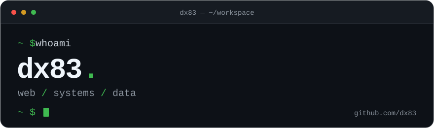

  

## `~/stack` $ cat stack.yml

**Languages**

**Web**

**Databases**

**Tools & Environment**

## `~/activity` $ git log --stat

## `~/contact` $ cat email.txt

---

<code>dx83@github:~$</code> <a href="https://github.com/dx83?tab=repositories">ls repositories</a>
